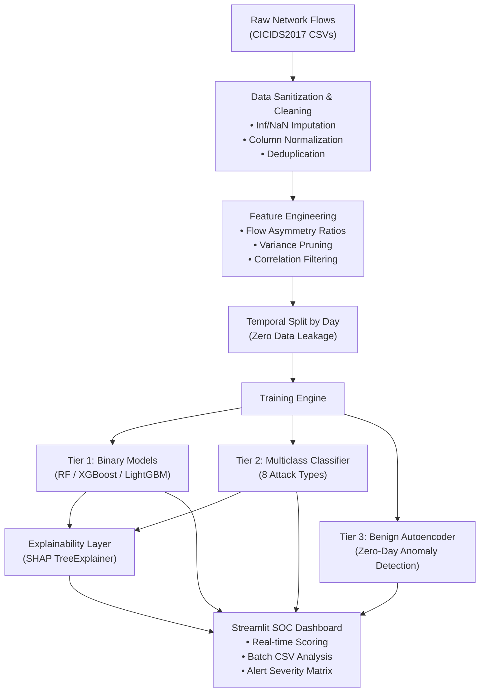

<div align="center">

# 🛡️ Network Intrusion Detection System (NIDS)

**Production-grade Machine Learning Pipeline for Network Threat Detection and Flow-Level Anomaly Analysis**

[](https://www.python.org/downloads/)
[](tests/)
[](https://github.com/astral-sh/ruff)
[](https://mypy-lang.org/)
[](LICENSE)

[Architecture](#-system-architecture) •
[Features](#-key-features) •
[Quick Start](#-quick-start) •
[Dataset](#-dataset-profile-cicids2017) •
[Pipeline Stages](#-pipeline-stages) •
[Dashboard](#-interactive-soc-dashboard) •
[Evaluation](#-evaluation-framework)

</div>

---

## 📌 Overview

This repository implements a modular, high-throughput **Network Intrusion Detection System (NIDS)** utilizing flow-level network telemetries from the **CICIDS2017** benchmark dataset. 

Rather than relying on resource-intensive Deep Packet Inspection (DPI), this system operates on aggregated bidirectional flow characteristics (timing, packet sizing, TCP flags, and volumetric ratios). It incorporates a multi-tier defense strategy:
1. **Binary Classification:** High-speed discrimination between benign and malicious flows.
2. **Multiclass Attack Identification:** Fine-grained taxonomy categorization across 8 attack families.
3. **Unsupervised Anomaly Detection:** Reconstruction error-based deep Autoencoder trained exclusively on benign traffic to flag zero-day vectors.
4. **Explainable AI (XAI):** SHAP (SHapley Additive exPlanations) attribution layer enabling SOC analysts to inspect why specific flows triggered an alert.

---

## 🏛️ System Architecture



---

## ✨ Key Features

- **Leakage-Free Validation:** Strict day/time-based dataset partitioning rather than random shuffling, preserving temporal independence and preventing optimistic metric inflation.
- **Extreme Class Imbalance Mitigation:** Dynamic class weighting, SMOTE oversampling, and controlled undersampling routines designed specifically for rare threat classes (<1% representation).
- **Multi-Model Consensus:** Out-of-the-box support for **Random Forest**, **XGBoost**, and **LightGBM**, preconfigured with production hyperparameters.
- **Zero-Day Anomaly Detector:** Deep MLP Autoencoder trained strictly on baseline benign flows, using reconstruction error thresholds ($p_{95}$ percentile) to isolate unknown anomalous payloads.
- **Model Explainability:** Global feature importance plots (beeswarm and summary bar charts) and local sample attribution to decipher flow anomaly signatures.
- **Operational Dashboard:** Full-featured Streamlit user interface featuring batch telemetry evaluation, interactive single-flow parameter simulators, and threat categorization badges.

---

## 📂 Repository Layout

```
├── config/
│   ├── model_config.yaml         # Central hyperparameters, label maps, and split rules
│   └── feature_list.yaml         # Categorized flow feature catalogue (timing, flags, volume)
├── src/
│   ├── data/
│   │   ├── loader.py             # Multi-file dataset ingestion and day tagging
│   │   ├── cleaner.py            # Inf/NaN sanitation, deduplication, and label encoding
│   │   └── preprocess.py         # End-to-end preprocessing orchestrator
│   ├── features/
│   │   ├── engineer.py           # Forward/backward ratios, variance & correlation pruners
│   │   └── balancer.py           # Imbalance handlers (class_weight, SMOTE, undersampling)
│   ├── models/
│   │   ├── train_binary.py       # Binary classifiers (Benign vs. Attack)
│   │   ├── train_multiclass.py   # Multiclass classifiers (8 attack taxonomies)
│   │   └── evaluate.py           # Recall-centric metric reporting, confusion matrices, ROC
│   ├── anomaly/
│   │   ├── autoencoder.py        # Keras Autoencoder architecture and threshold engine
│   │   └── train_autoencoder.py  # Anomaly detector training script
│   ├── explainability/
│   │   ├── shap_explainer.py     # TreeExplainer wrapper for global/local attributions
│   │   └── run_shap.py           # CLI runner for diagnostic visual assets
│   └── dashboard/
│       └── app.py                # Interactive Streamlit monitoring dashboard
├── notebooks/
│   └── 01_eda.py                 # Exploratory data analysis and feature inspection
├── tests/                        # 24 unit tests covering cleaning, features, and training
├── Makefile                      # Standardized project execution CLI
├── requirements.txt              # Production dependencies
└── setup.py                      # Package installation script
```

---

## 📊 Dataset Profile (CICIDS2017)

The model is structured for the **CICIDS2017** benchmark, generated by the Canadian Institute for Cybersecurity:

| Protocol Day | Target Traffic Scenarios | Class Grouping |
|---|---|---|
| **Monday** | Normal Baseline Activity | `BENIGN` |
| **Tuesday** | FTP-Patator, SSH-Patator | `Brute Force` |
| **Wednesday** | DoS Slowloris, Slowhttptest, Hulk, GoldenEye, Heartbleed | `DoS / DDoS` |
| **Thursday** | Web Attacks (XSS, SQL Injection), Infiltration | `Web Attack`, `Infiltration` |
| **Friday** | PortScan, Botnet (ARES), High-volume DDoS | `Port Scan`, `Botnet`, `DDoS` |

---

## 🚀 Quick Start

### 1. Installation

Clone the repository and install dependencies:

```bash
git clone https://github.com/parth2024-tech/network-intrusion-detection-system.git
cd network-intrusion-detection-system

# Install dependencies and local package in editable mode
make install
```

### 2. Dataset Setup

Download `MachineLearningCSV.zip` from the [UNB CICIDS2017 portal](https://www.unb.ca/cic/datasets/ids-2017.html) and extract the CSV files into `data/raw/`:

```bash
# Verify raw CSV files are present
ls -lh data/raw/*.csv
```

### 3. Pipeline Execution

Run the complete pipeline using the automated Makefile:

```bash
# Step 1: Preprocess raw flows, apply feature engineering, scale, and partition
make preprocess

# Step 2: Train baseline binary classifiers (Random Forest, XGBoost, LightGBM)
make train-binary

# Step 3: Train multiclass threat classifiers
make train-multi

# Step 4: (Optional) Train Autoencoder anomaly detector
make train-autoencoder

# Step 5: Compute SHAP feature attributions
make shap

# Step 6: Launch the interactive Streamlit SOC dashboard
make dashboard
```

---

## 🖥️ Interactive SOC Dashboard

Launch the UI locally:

```bash
streamlit run src/dashboard/app.py
```

### Dashboard Capabilities:
- **Telemetry Overview:** Visual summary of flow volumes, benign/attack distribution, and dataset metadata.
- **Model Evaluation:** Interactive confusion matrices, multi-model performance charts, and per-class precision/recall curves.
- **Real-Time Flow Scoring:** Batch upload flow CSVs to generate immediate classifications with exportable incident reports.
- **Single Flow Simulator:** Adjust flow duration, packet sizes, and flag counts via sliders to observe real-time model decision dynamics and severity scoring.
- **Explainability Explorer:** Embedded SHAP beeswarm and feature impact rankings explaining flagged anomalies.

---

## 🎯 Evaluation Framework

In intrusion detection, **Recall on attack classes is prioritized** over overall accuracy:
$$\text{Recall} = \frac{\text{True Positives}}{\text{True Positives} + \text{False Negatives}}$$

- Missing an active intrusion (False Negative) carries catastrophic operational cost.
- False alarms (False Positives) can be triaged by analysts or secondary filters.
- Model selection and threshold tuning default to maximizing **Macro F1** and **Attack Recall**.

---

## 🧪 Testing & Code Quality

The repository includes a comprehensive unit test suite and strict type checking:

```bash
# Run unit tests
pytest tests/ -v

# Run formatting and linting
ruff check .

# Run static type checking
mypy . --ignore-missing-imports
```

---

## 📜 Citation

If you use this project or the CICIDS2017 dataset in your research, please cite:

```bibtex
@inproceedings{sharafaldin2018toward,
  title={Toward Generating a New Intrusion Detection Dataset and Intrusion Traffic Characterization},
  author={Sharafaldin, Iman and Habibi Lashkari, Arash and Ghorbani, Ali A},
  booktitle={Proceedings of the 4th International Conference on Information Systems Security and Privacy (ICISSP)},
  pages={108--116},
  year={2018}
}
```

---

## 📄 License

This project is licensed under the [MIT License](LICENSE).
